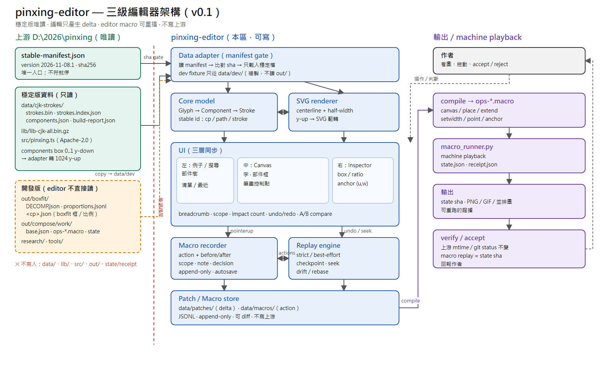

# pinxing-editor — 拼形三級編輯器（快速原型）

> **版本：0.1.0**（D0–D5 完成：manifest gate、三層選取、拖曳 patch、控制點、undo/redo、
> A/B、例子、存檔重播、accept §8 全綠；含操作導覽演示）
>
> **筆畫 → 部件 → 字** 的三層編輯器。開一個字，三層同步選取；拖部件框／筆畫控制點，
> 即時預覽；每一次判斷都錄成 action，可重播、可 diff、可在穩定版更新後重跑。
>
> 這是**原型**，不是字型產品：先在本機 `127.0.0.1` 跑，不發布。



> 圖的節點、邊與不變量見 [`docs/architecture.md`](docs/architecture.md)；
> 可編輯來源是 [`docs/architecture.svg`](docs/architecture.svg)。

## 只讀穩定版

上游 `D:\2026\pinxing` 分兩層：

- **穩定版（只讀）**：`data/cjk-strokes/`、`lib/lib-cjk-all.bin.gz`、`src/pinxing.ts`。
  入口是 `D:\2026\pinxing\stable-manifest.json`（目前 `2026-11-08.1`）；啟動比對 sha。
- **開發版（不讀）**：`out/boxfit/`、`out/compose/work/`、`research/`、`tools/`。
  真的需要範例就**複製**到 `data/dev/`，標 `dev fixture`。

本區只寫自己的 `data/patches/`、`data/macros/`、`data/dev/` 與原始碼；**不寫上游**。

## 目錄

```text
pinxing-editor/
├─ AGENTS.md        # 這一區的規則（先讀）
├─ README.md        # 這頁
├─ vite.config.ts   # dev server ＋ stable bridge（唯讀、role 白名單、sha gate）
├─ index.html
├─ src/
│  ├─ data/         # stable.ts（manifest gate）· strokes.ts · components.ts
│  ├─ model/        # Selection（stable id）
│  ├─ render/       # SVG：中心線＋半寬；y-up 翻轉
│  ├─ tour/         # 操作導覽播放器（shell.css · player · compiler）
│  ├─ style.css     # 暗色 UI
│  └─ main.ts       # 開字／選取／拖曳／undo-redo／導覽接線
├─ tours/
│  └─ demo.tour     # 操作導覽劇本（改完跑 bun run tour:build）
├─ tour.config.ts   # 導覽編譯設定（allow-list 對齊 main.ts）
├─ scripts/
│  ├─ d0-check.ts   # 6 檔 sha 全綠 ＋ 908F parse ＋ components 樹
│  ├─ check-upstream.ts  # 上游 sha／mtime 對基線
│  ├─ accept.ts     # §8 七項驗收（用 node 跑）
│  └─ tour-demo.ts  # 自動播完演示＋錄影（用 node 跑）
├─ data/            # dev fixture、patches、macros（不放穩定版大檔）
├─ out/             # build／preview／test 產物（不進版控）
├─ public/          # 靜態資源
└─ docs/
   ├─ FAST-PROTOTYPE.md
   ├─ DATA-CONTRACT.md
   ├─ STABLE-INPUTS.md
   ├─ MACRO-RECORD-PLAYBACK.md
   ├─ KEYWORDS.md
   └─ steps.md
```

## 快速開始

```powershell
cd D:\2026\pinxing-editor
bun install
bun run d0-check    # 穩定版 6 檔 sha 比對 ＋ 908F／components 解析（唯讀上游）
bun run dev         # http://127.0.0.1:5173，自動開 908F
node scripts/accept.ts  # §8 七項驗收（必須用 node；bun+playwright CDP 會掛）
bun run tour:demo   # 自動播完操作導覽＋錄影 out/tour-demo.webm
```

- 瀏覽器不直接讀 `D:\2026\pinxing`；dev server 內的 **stable bridge** 只轉發
  manifest 列出的 role，serve 前比對 sha256，不符就 502「穩定版已變更」。
- `bun run d0-check` 目前全綠：908F = 22 筆 / 63 點、部件樹 `⿺[辶, 羅]` 3 葉。

## 先讀哪幾份

1. [`AGENTS.md`](AGENTS.md) — 工作區規則、只讀邊界。
2. [`docs/WHY-THREE-LAYERS.md`](docs/WHY-THREE-LAYERS.md) — 為什麼漢字不能 per-glyph contour 調；三層的作用域。
3. [`docs/STABLE-INPUTS.md`](docs/STABLE-INPUTS.md) — manifest 是唯一入口。
4. [`docs/FAST-PROTOTYPE.md`](docs/FAST-PROTOTYPE.md) — 5 天里程碑與驗收。
5. [`docs/DATA-CONTRACT.md`](docs/DATA-CONTRACT.md) — 上游格式與座標轉換。
6. [`docs/MACRO-RECORD-PLAYBACK.md`](docs/MACRO-RECORD-PLAYBACK.md) — 錄製／重播設計。
7. [`docs/KEYWORDS.md`](docs/KEYWORDS.md) — 術語表。

## 操作導覽（演示播放）

- 介面工具列 **🦮** 一鍵播放 `tours/demo.tour`：開字 → 三層選取 → 拖部件框 →
  控制點＋A/B → undo/redo → 存檔重播。所有模擬操作由播放器執行，跟著看就行；
  `停` 的地方點畫面任何地方（或空白鍵）繼續，Esc 結束，之後可從 🦮 再看一次。
- 劇本是 Markdown 方言（`###` 場景、`>` 指令），改完跑 `bun run tour:build`；
  `bun run tour:check` 確認編譯產物沒過期（`#id` 選擇器與 `api:` 鍵在編譯期驗）。
- `bun run tour:demo`（node）自動全播並斷言：零失敗步驟、聚光燈對準、拖曳真產生 patch、
  重播 sha 相同、console error = 0；輸出 `out/tour-demo.webm` 錄影＋每場景截圖。

## 限制（第一版）

- 只做單字編輯與搜尋，不做全 21k 字虛擬滾動。
- 不做多人／雲端。存儲第一版仍是 JSON（**作者 2026-11-08 授權可用 SQLite**；
  跑在 localhost，最終併入 Wails3——資料一律走後端 API，不走瀏覽器直寫檔案）。
- 不做字型匯出、KAGE 編輯、`merge`／`clip`、自動排版求解器。
- 交錯／包圍的部件框允許重疊；不要用 `gap>=0` 當硬規則。
